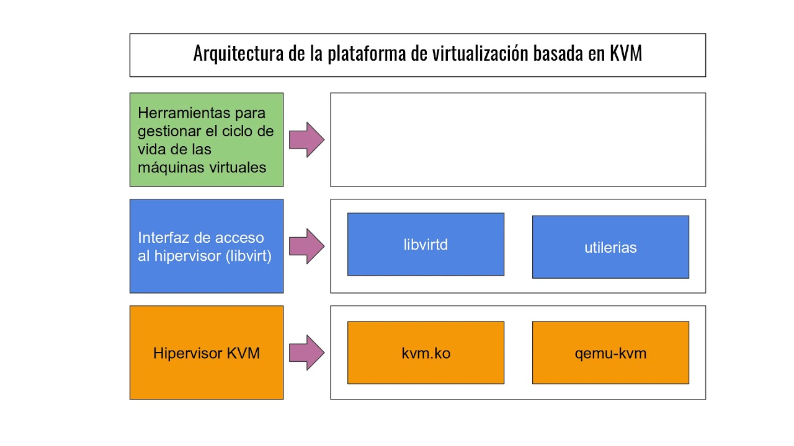
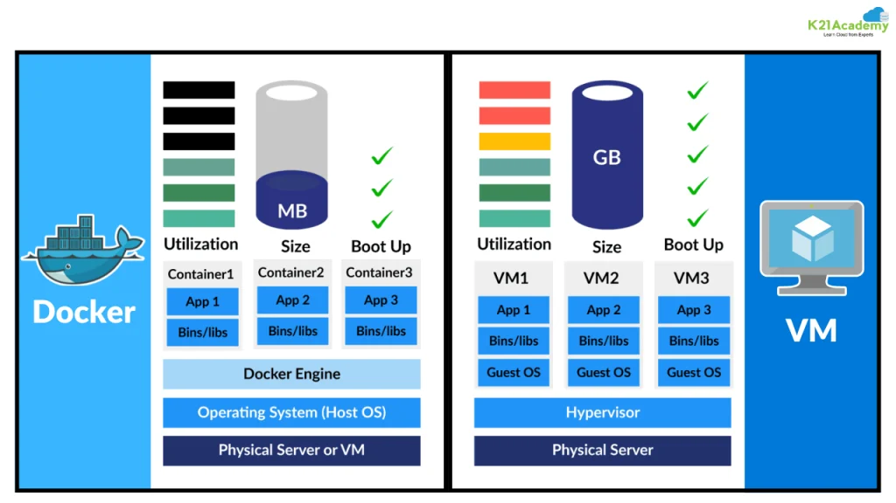

# Virtualización

---

## *¿Qué es la virtualización?*

La virtualización es la tecnología que permite crear distintos entornos virtuales desde un solo equipo físico.  
Es decir: a partir de un recurso físico, se pueden virtualizar varios recursos virtuales.

Ejemplos:
> VLAN (redes virtuales), VM (sistemas operativos virtuales), VDI (virtualización de escritorios)

---

---

## **Algunos tipos de virtualización**

### *Virtualización de servidores*

- Divide un servidor físico en múltiples VM aisladas.
- Permite ejecutar diferentes sistemas operativos de forma optimizada.
- Se gestiona con hipervisores de tipo 1 o tipo 2.

> EJ: Proxmox, VMware

### *Virtualización de escritorios (VDI)*

- Permite a los usuarios acceder a entornos de escritorio remotos.
- Centraliza el almacenamiento de datos.
- Orquesta la relación usuario-contexto y usuario-contenido.
- Permite el acceso desde cualquier dispositivo apto.

> EJ: Servicio de Escritorio Remoto (Windows local), Amazon WorkSpaces (varios sistemas operativos en la nube)

### *Virtualización de redes*

- Crea redes virtuales sobre la infraestructura física mediante tecnologías como VPN, VLAN y SDN.
- Abstrae el hardware, simplificando la gestión y aportando flexibilidad.

## *Conceptos básicos: virtualización de S.O. y VM*

En esta capacitación nos centraremos en la virtualización de sistemas operativos y máquinas virtuales con fines prácticos.

Cuando hablamos de virtualizar, entran dos términos importantes:
- Hipervisor
- Máquina virtual

### *Máquina virtual*

- Son el producto final de la virtualización.
- Ofrecen un aislamiento casi total entre los diferentes sistemas operativos instalados en el hardware.

### *Hipervisor*

- Gestiona y administra el hardware.
- Supervisa las VM (VMM).
- Existen dos tipos de hipervisores:

> Tipo 1:  
> De servidor dedicado (*bare metal*). Se ejecutan directamente sobre el hardware del host (equipo físico) para gestionar los sistemas operativos *guest* (S.O. de las VM).  
> EJ: Proxmox, Citrix

> Tipo 2:  
> Hipervisor alojado. Se ejecuta dentro de un sistema operativo convencional como una capa de software.  
> Funciona abstrayendo los sistemas operativos *guest* del host.  
> EJ: VirtualBox, VMware Workstation

## *Otros conceptos interesantes*

### *De tipo KVM*

- VM basadas en kernel, utilizadas para virtualización en Linux.
- Permiten rendimiento y encapsulamiento similares a un hipervisor tipo 1 dentro de un sistema operativo convencional.

### *Docker y contenedores*

El sistema de contenedores no es virtualización de hardware y no genera VM.  
Se podría decir que virtualiza aplicaciones sobre un sistema operativo.

- Se ejecutan sobre el mismo kernel que el S.O. anfitrión.
- El contenedor empaqueta únicamente la aplicación y sus dependencias.
- Docker Engine se encarga de aislar los procesos.

---

---

## *Virtualización en RAZ*

En RAZ utilizamos Proxmox como hipervisor de tipo 1, por lo que es un sistema operativo dedicado a la virtualización.

En Proxmox se pueden manejar clústeres de servidores físicos; es decir, varios servidores físicos conectados al mismo sistema de gestión, comunicados entre sí pero aislados entre ellos.  
Si se rompe el hipervisor A, no necesariamente debe afectar al hipervisor B.

Proxmox, como ecosistema, cuenta con varias herramientas, de las cuales utilizamos:

- Proxmox Virtual Environment: entorno de virtualización de VM.
- Proxmox Backup Server: gestor y almacenador de backups remotos para sistemas Proxmox.

Contamos con un clúster en Trelles compuesto por dos hipervisores, además de un hipervisor principal por sucursal en Capital y un hipervisor de respaldo con las VM actualizadas (Monte, Vélez).

Además, hay un Proxmox Backup Server en cada sucursal mencionada.

| Proxmox | Tipo | Sucursal |
|---|---|---|
| pve01 | Hipervisor | Trelles |
| pve02 | Hipervisor | Trelles |
| pve09 | Hipervisor | Montenegro |
| pve07 | Hipervisor de respaldo | Montenegro |
| pve04 | Hipervisor | Vélez |
| pve05 | Hipervisor de respaldo | Vélez |
| pbs01 | Backup Server | Trelles |
| pbs02 | Backup Server | Montenegro |
| pbs03 | Backup Server | Vélez |

---

---

## *Para completar juntos*

Qué virtualizamos y cómo usamos las herramientas de Proxmox.

---

---

### *Actividad*

---

1) Crear VM MinOS Win10 en ambiente Proxmox ✅  
2) Backupear la VM creada en local.  ✅
3) Borrar la VM creada y restaurarla.✅

### *Actividad para el viernes*

Con un hipervisor de tipo 2 a elección:

1) Armar 2 máquinas virtuales Windows (VM-A y VM-B).  
2) Armar una VM Linux con la distro a elección (VM-C).

### Requisitos a cumplir:

- VM-A y VM-B se deben poder comunicar entre sí (ping entre ellas), pero no deben poder acceder a internet (el ping a 8.8.8.8 no debe funcionar).
- VM-C no debe comunicarse con VM-A ni VM-B, pero sí debe tener acceso a internet (el ping a 8.8.8.8 debe funcionar).
- VM-C no debe poder comunicarse mediante ping con el equipo host (tu computadora; el ping desde la VM a tu IP no debe responder). -> Opcional

---
